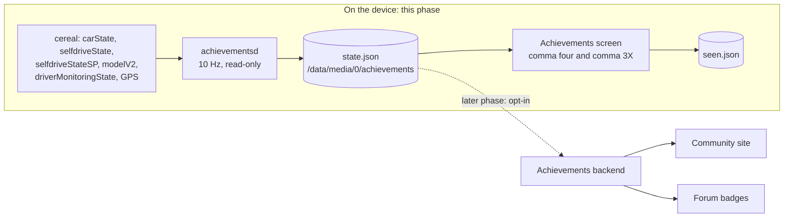
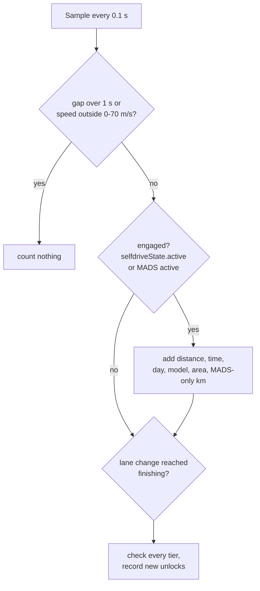

# Achievements: phase 1, on the device

## Status: built, tested off-device, not yet run on a car

Phase 1 of the sunnypilot community plan. The device counts driving stats and unlocks achievements, and shows them on
an Achievements screen. Nothing leaves the device yet; sharing, the community site, leaderboards, groups, the map and
contests come in later phases on a separate backend.

## Where it fits

## How a drive is counted

- **Engaged** means `selfdriveState.active` (including driver override) or MADS lateral active. MADS-only distance
  is MADS active without `selfdriveState.active`.
- **Days** (Regular, Streak, Road Trip, Four Seasons) need a valid wall clock. Before the clock is set, distance still
  counts but no day does. The calendar day comes from GPS longitude (15 degrees per hour), since the device clock runs
  in UTC; without GPS it falls back to the system zone. Southern-hemisphere fixes flip the seasons.
- **Explorer areas** are geohash cells of about 5 km, salted with a random per-device salt and SHA-256 hashed before
  they are stored. No coordinates are written anywhere.
- **Attentive** is the longest engaged stretch without a red (level three) driver monitoring alert.
- **Dev Branch Brave** counts on any channel that is not a release channel, plus staging channels.

## Catalog

`openpilot/sunnypilot/achievements/catalog.json`, 14 achievements and 32 tiers. Unlock ids are `odometer.silver`, or
just `first_light` for single-tier ones, so a later backend can map them one-to-one to badges.

| Achievement | Measures | Tiers |
| --- | --- | --- |
| First Light | engaged km | 0.1 |
| Odometer | engaged km | 100 / 1,000 / 10,000 / 50,000 |
| Captain's Hours | engaged hours | 10 / 100 / 1,000 |
| Regular | days engaged | 7 / 30 / 100 / 365 |
| Streak | days in a row | 7 / 30 |
| Steady Hands | MADS-only km | 100 / 1,000 |
| Smooth Merger | assisted lane changes | 10 / 100 / 1,000 |
| Road Trip | km in one day | 500 |
| Explorer | 5 km areas | 5 / 25 / 100 |
| Model Hopper | models with 50+ km | 3 / 5 / 10 |
| Dev Branch Brave | km on dev or staging | 100 |
| Attentive | hours without a red DM alert | 10 / 50 / 100 |
| Four Seasons | seasons driven | 4 |
| Linked Up | sunnylink on and registered | yes |

Safety rules for anything added here: never reward speed, hard driving, night or fatigue driving, or fewer
takeovers, and never show anything while driving.

## Why a state file, not Params

This is a prebuilt branch: a new Params key means rebuilding the ARM64 `libparams_c.so` (see
`openpilot/tools/params/README.md`). Progress lives in `/data/media/0/achievements/state.json` instead, written
atomically every 30 s and when the drive ends. It survives updates. The UI keeps its own `seen.json`, so the daemon and
the UI never write the same file. A corrupt state file is moved to `state.corrupt.json` instead of being overwritten.

## Files

| File | What it is |
| --- | --- |
| `sunnypilot/achievements/catalog.json`, `catalog.py` | the goals, and display text for both UIs |
| `sunnypilot/achievements/engine.py` | pure Python counting and unlocks, no cereal or Params |
| `sunnypilot/achievements/achievementsd.py` | onroad process that feeds the engine from cereal |
| `system/manager/process_config.py` | registers `achievementsd` as `only_onroad` |
| `selfdrive/ui/sunnypilot/achievements_store.py` | shared reader for both screens |
| `selfdrive/ui/sunnypilot/mici/layouts/achievements.py` | comma four screen, plus the settings button with "N new" |
| `selfdrive/ui/sunnypilot/layouts/settings/achievements.py` | comma 3X settings panel |

## Testing

`pytest openpilot/sunnypilot/achievements/tests openpilot/selfdrive/ui/sunnypilot/tests/test_achievements_store.py`
(26 tests, no device libraries needed). The screens and achievementsd were syntax- and lint-checked only: the UI and
cereal libraries on this branch are ARM64 builds, so neither has run yet. First drive to check: the process starts
onroad, `state.json` appears within 30 s of engaging, and the comma four settings show "achievements" with
"2 new" (First Light, and Linked Up if sunnylink is on) after the drive.
